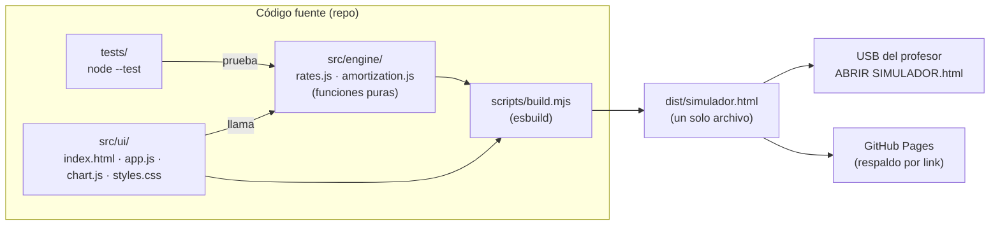

# Blueprint de arquitectura — Simulador de Crédito con Abonos a Capital

- **Autor:** Cristian D Avella
- **Última actualización:** 2026-11-16
- **Estado:** Inicial. Describe la arquitectura planeada; todavía no hay código.

## 1. Propósito

Software para el proyecto final de Ingeniería Económica. Simula un crédito de cuota fija (sistema francés), convierte entre expresiones de tasa y permite registrar abonos extraordinarios a capital, eligiendo en cada uno si reduce la cuota o el plazo. Requisitos: `docs/requirements/requirements-simulador-credito.md`.

## 2. Componentes



| Componente | Responsabilidad | No hace |
|---|---|---|
| `src/engine/rates.js` | Convertir cualquier tasa (efectiva o nominal, m periodos, vencida o anticipada) a cualquier otra, usando la EA como pivote | Leer formularios, formatear texto |
| `src/engine/amortization.js` | Generar la tabla de amortización con abonos (reducir cuota o plazo), el resumen y la comparación con y sin abonos | Convertir tasas: recibe la tasa mensual vencida ya convertida |
| `src/ui/` | Formularios, validación visible, tablas, gráfica SVG, panel de fórmulas, formato colombiano de números | Hacer cálculos financieros |
| `scripts/build.mjs` | Empaquetar todo en un solo HTML y verificar que no tenga referencias externas | — |
| `tests/` | Casos de `calculation-flow.md` §1 y §2.3 | Probar la interfaz |

## 3. Flujo de datos principal

1. El usuario ingresa monto, plazo, tasa (valor y tipo) y abonos.
2. La UI llama a `rates.convert(tasa, {efectiva, m: 12, vencida})` y obtiene la tasa mensual `i`.
3. La UI llama a `amortization.simulate({P, i, n, abonos})` dos veces, con abonos y sin abonos.
4. El motor devuelve filas, resumen y errores de validación por abono.
5. La UI pinta el resumen, la comparación, la tabla, la gráfica y las fórmulas usadas.

Los algoritmos están en `docs/architecture/calculation-flow.md`.

## 4. Invariantes

- El motor no usa el DOM ni la red, y no depende de la UI (ADR-002).
- El entregable no tiene ninguna referencia a recursos externos y funciona sin internet (ADR-001, RNF-01).
- Los cálculos usan precisión completa. Se redondea solo al mostrar (`calculation-flow.md` §3.1).
- Ningún dato del usuario sale de su navegador (RNF-05).

## 5. Stack

| Pieza | Elección | Justificación |
|---|---|---|
| Lenguaje | JavaScript plano (módulos ES) | Corre en cualquier navegador sin instalar nada (ADR-002) |
| Build | esbuild | Empaqueta todo en un archivo; solo se usa al desarrollar |
| Pruebas | `node --test` | Nativo de Node, sin dependencias |
| Gráfica | SVG propio | No se puede usar CDN (ADR-001) |
| Hosting de respaldo | GitHub Pages + Actions | Publicación automática tras pasar las pruebas (ADR-003) |

## 6. Estructura de directorios

```
.
├── docs/
│   ├── requirements/requirements-simulador-credito.md
│   └── architecture/
│       ├── architecture-blueprint.md
│       ├── calculation-flow.md
│       └── adrs/
├── src/
│   ├── engine/        # rates.js, amortization.js
│   └── ui/            # index.html, app.js, chart.js, styles.css
├── tests/             # *.test.mjs
├── scripts/build.mjs
├── .github/workflows/ # deploy a Pages
└── dist/              # salida del build (no versionada)
```
