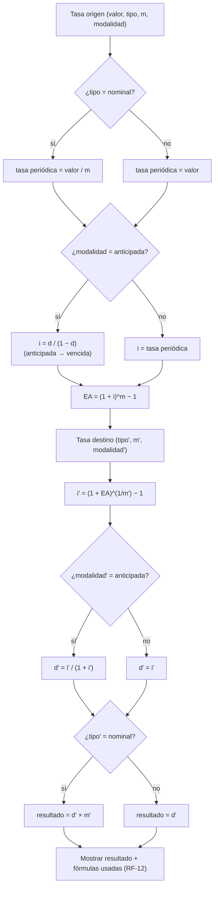
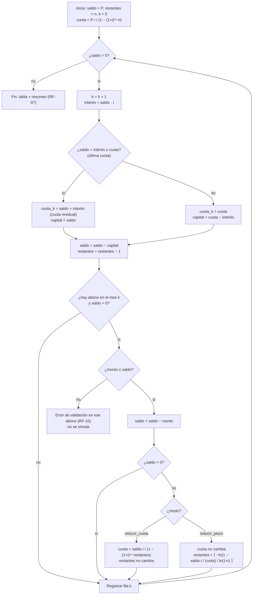

# Flujo de cálculo — Conversión de tasas y tabla de amortización con abonos

- **Estado:** Aceptado (2026-11-16) por Cristian D Avella, incluidas las recomendaciones de §3.1 (precisión completa, redondeo al mostrar) y §3.2 (máximo un abono por mes)
- **Requisitos:** RF-04, RF-04b, RF-05 a RF-11 (`docs/requirements/requirements-simulador-credito.md`)

Este documento es la fuente de verdad de los algoritmos. Los cambios se hacen primero aquí y después en el código.

---

## 1. Conversión de tasas (RF-04, RF-04b)

### 1.1 Modelo de una tasa

Toda tasa se describe con cuatro datos:

| Campo | Valores | Ejemplo |
|---|---|---|
| `valor` | número en % | 22,08 |
| `tipo` | `efectiva` \| `nominal` | nominal |
| `m` | periodos por año: 12 mensual, 6 bimestral, 4 trimestral, 2 semestral, 1 anual | 12 |
| `modalidad` | `vencida` \| `anticipada` | vencida |

Ejemplos: "1,84 % MV" = (1,84, efectiva, 12, vencida); "22,08 % NAMV" = (22,08, nominal, 12, vencida); "24,46 % EA" = (24,46, efectiva, 1, vencida).

### 1.2 Algoritmo: cualquier tasa → EA → cualquier tasa

La EA es el pivote: todas las tasas se convierten primero a EA y desde ahí a la expresión que se pida. Así se evita escribir una fórmula por cada par de tasas.

**Uso en el simulador de crédito:** la tasa que ingresa el usuario se convierte siempre a destino (efectiva, m' = 12, vencida), es decir, a la tasa efectiva mensual vencida `i` que usa la tabla.

**Validaciones:** valor > 0. Si la modalidad es anticipada, la tasa periódica debe ser < 100 %, porque si no `1 − d ≤ 0`.

**Casos de prueba:**

| Origen | Destino | Esperado |
|---|---|---|
| 1,84 % efectiva mensual vencida | EA | 24,4574 % |
| 1,84 % efectiva mensual vencida | NAMV | 22,08 % |
| 24,4574 % EA | efectiva mensual vencida | 1,84 % |
| 2 % efectiva mensual anticipada | efectiva mensual vencida | 2,0408 % |
| X (cualquiera) | la misma expresión | X (ida y vuelta, ±1e-9) |

---

## 2. Tabla de amortización con abonos (RF-05 a RF-11)

### 2.1 Entradas y estado

- **Entradas:** monto `P`, tasa efectiva mensual `i` (de §1), plazo `n` en meses, y la lista de abonos `{mes, monto, modo}`, con `modo ∈ {reducir_cuota, reducir_plazo}`.
- **Estado que se arrastra mes a mes:** `saldo`, `cuota` vigente, `restantes` (cuotas que faltan según el plan vigente) y `k` (número de cuota).

La variable `restantes` es la que permite combinar los dos modos. Por ejemplo, si un abono reduce el plazo y uno posterior reduce la cuota, la nueva cuota se calcula sobre el plazo ya acortado.

### 2.2 Algoritmo

**Convenciones** (supuestos A5 y A6, que se declaran en pantalla):
1. El abono se aplica **después** de la cuota ordinaria del mes y va 100 % a capital.
2. Si se reduce el plazo, la última cuota es **residual**: es igual a saldo + interés y puede ser menor que la cuota vigente.
3. Si un abono posterior reduce la cuota, la nueva cuota se calcula sobre `restantes` y la residual desaparece, porque todas las cuotas vuelven a ser iguales.
4. Un abono en un mes en el que el crédito ya está cancelado (por abonos anteriores) es un error de validación (RF-10). Se informa al usuario indicando cuál abono es.

**Comparación (RF-11):** el mismo algoritmo se ejecuta dos veces, sin abonos y con abonos. Se reporta: intereses ahorrados, cuotas ahorradas y cuota final vigente.

### 2.3 Casos de prueba (verificados con un prototipo el 2026-11-16)

Crédito base: $10.000.000, 2 % mensual vencida, 12 meses → cuota $945.596; intereses totales sin abonos: **$1.347.153**.

| Escenario | Resultado esperado |
|---|---|
| Sin abonos | 12 cuotas de $945.596, saldo final $0 |
| Abono de $2.000.000 en el mes 3, **reducir cuota** | Saldo $5.718.178; cuotas 4–12 de **$700.565**; 12 cuotas en total; intereses $1.141.875 (ahorro ≈ $205.278) |
| Abono de $2.000.000 en el mes 3, **reducir plazo** | Cuotas 4–9 de $945.596 y cuota 10 residual de **$484.157**; 10 cuotas en total; intereses $994.520 (ahorro ≈ $352.633) |
| Referencia Bancolombia: $200 M, 1,84 % MV, 84 meses | Cuota $4.695.074; mes 1: interés $3.680.000, capital $1.015.074, saldo $198.984.926 |
| Abono igual al saldo | Crédito cancelado en ese mes; no quedan filas después |
| Abono mayor al saldo | Error de validación indicando cuál abono es |

---

## 3. Decisiones del algoritmo (resueltas el 2026-11-16: alternativa A en ambas)

### 3.1 Redondeo

| Alternativa | Gana | Pierde |
|---|---|---|
| **A. Precisión completa internamente; redondear a pesos solo al mostrar** (recomendada) | Matemáticamente exacto: el saldo final da $0 sin ajustes y coincide con la referencia de Bancolombia | Una columna de la tabla puede no sumar exactamente, con diferencias de ±$1 |
| B. Redondear cada fila a pesos y ajustar la última cuota | Cada fila suma exactamente, como en un extracto bancario | La última cuota difiere unos pesos de las demás, y hay que explicar ese ajuste |

### 3.2 Varios abonos en el mismo mes

| Alternativa | Gana | Pierde |
|---|---|---|
| **A. Máximo un abono por mes** (recomendada) | Regla simple y sin ambigüedad | Quien quiera abonar dos veces en un mes debe sumarlos a mano |
| B. Permitir varios y aplicarlos en el orden registrado | Más flexible | Si tienen modos distintos, el resultado depende del orden, algo difícil de explicar en la sustentación |
